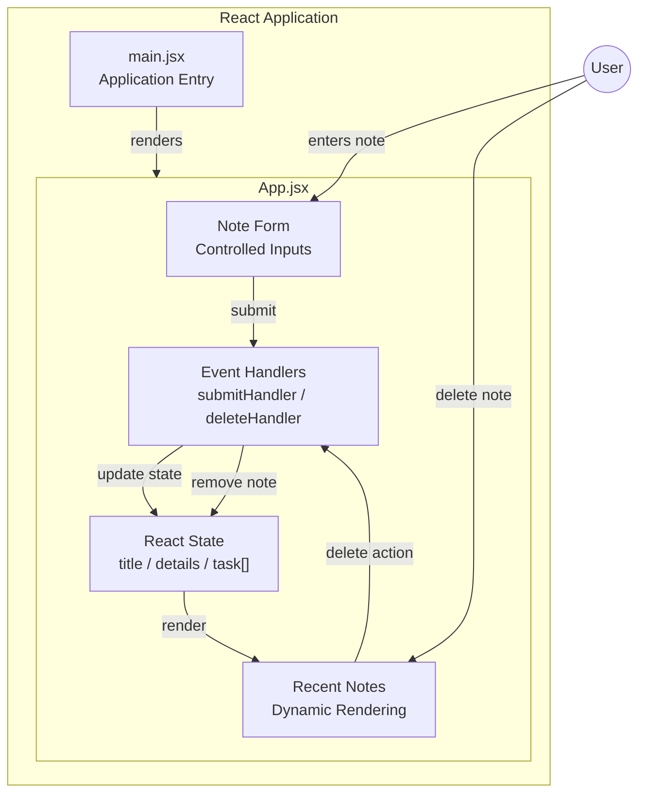

# 📝 NotesApp

<div align="center">

**A simple and responsive note-taking application built with React**

Create Notes • View Recent Notes • Delete Notes


</div>

---

## 📌 Overview

**NotesApp** is a frontend note-taking application built using **React, Vite, JavaScript, and Tailwind CSS**.

The project was created to practice and strengthen core React concepts through a working application, including **state management, controlled inputs, event handling, dynamic rendering, and responsive UI design**.

Users can create notes by entering a title and description, view their recent notes, and delete notes when they are no longer needed.

---

## ✨ Features

* 📝 Create notes with a title and description
* 📋 Display recently created notes
* 🗑️ Delete individual notes
* ⚡ Instant UI updates using React state
* 📱 Responsive layout
* 🎨 Tailwind CSS based styling
* 🧩 Lucide React icons
* 🚀 Fast development using Vite

---

## 🖥️ Demo & Screenshot

### 🌐 Live Demo

**Live Demo:** Add your deployed Vercel/Netlify link here

### 📸 Application Preview

Add a screenshot of your application here:

```md

```

> 💡 Recommended: Add a screenshot showing the note creation form and multiple notes displayed in the Recent Notes section.

---

## 🏗️ Architecture

NotesApp follows a simple **client-side React architecture** where application data is maintained using React state.



### 🔄 Application Flow

```text
User Input
     ↓
Form Submission
     ↓
Event Handler
     ↓
React State Update
     ↓
React Re-render
     ↓
Updated Notes UI
```

### Architecture Explanation

**1. User Input**

The user enters the note title and description through controlled form fields.

**2. Event Handling**

The form submission is handled by `submitHandler()`.

**3. State Management**

Notes are stored inside the React `task` state array.

**4. Dynamic Rendering**

The notes are displayed dynamically using JavaScript's `map()` method.

**5. Delete Action**

The user can remove a note using the delete button.

**6. UI Update**

React automatically re-renders the interface whenever the state changes.

---

## 🧠 React Concepts Practiced

| Concept               | Usage                             |
| --------------------- | --------------------------------- |
| Functional Components | Main application component        |
| `useState`            | Managing notes and form values    |
| Controlled Inputs     | Title and description fields      |
| Event Handling        | Submit and delete actions         |
| Array State           | Managing multiple notes           |
| `map()`               | Rendering notes dynamically       |
| State Updates         | Adding and deleting notes         |
| Responsive Design     | Tailwind CSS responsive utilities |

---

## 🛠️ Tech Stack

### Frontend

* **React 19**
* **JavaScript**
* **Tailwind CSS 4**
* **Lucide React**

### Development Tools

* **Vite**
* **ESLint**
* **Git**
* **GitHub**

---

## 📁 Project Structure

```text
NotesApp-Project/
│
├── public/
│
├── src/
│   ├── App.jsx
│   ├── main.jsx
│   └── ...
│
├── package.json
├── vite.config.js
├── eslint.config.js
└── README.md
```

### Important Files

| File           | Purpose                              |
| -------------- | ------------------------------------ |
| `src/App.jsx`  | Main application logic, state and UI |
| `src/main.jsx` | React application entry point        |
| `package.json` | Dependencies and project scripts     |
| `README.md`    | Project documentation                |

---

## 🚀 Getting Started

### Prerequisites

Make sure you have **Node.js** and **npm** installed.

### 1. Clone the repository

```bash
git clone https://github.com/anshikagarga/NotesApp-Project.git
```

### 2. Navigate to the project

```bash
cd NotesApp-Project
```

### 3. Install dependencies

```bash
npm install
```

### 4. Start the development server

```bash
npm run dev
```

Open the local URL provided by Vite in your browser.

---

## 📦 Available Scripts

| Command           | Description              |
| ----------------- | ------------------------ |
| `npm run dev`     | Start development server |
| `npm run build`   | Create production build  |
| `npm run preview` | Preview production build |
| `npm run lint`    | Run ESLint               |

---

## 💡 Core Implementation

### Managing Notes

Notes are maintained using React's `useState` hook:

```jsx
const [task, setTask] = useState([]);
```

### Adding a Note

When the form is submitted, a new note is added to the state:

```jsx
const copyTask = [...task];

copyTask.push({
    title,
    details
});

setTask(copyTask);
```

### Deleting a Note

The selected note is removed from the notes array:

```jsx
const deleteTask = [...task];

deleteTask.splice(idx, 1);

setTask(deleteTask);
```

This project demonstrates the React approach of **updating state and allowing React to re-render the UI**, rather than directly manipulating the DOM.

---

## ⚠️ Current Limitations

This version is intentionally frontend-only.

* Notes are stored only in React state.
* Notes disappear after refreshing the page.
* No backend API.
* No database persistence.
* No authentication.
* Notes cannot currently be edited.

---

## 🔮 Future Enhancements

The application can be extended into a complete full-stack notes platform.

* [ ] 💾 Local Storage persistence
* [ ] ✏️ Edit notes
* [ ] 🔍 Search notes
* [ ] 🏷️ Categories and tags
* [ ] 📌 Pin important notes
* [ ] 📅 Add timestamps
* [ ] 🌙 Dark mode
* [ ] 🔐 User authentication
* [ ] 🌐 REST API
* [ ] 🗄️ Database integration
* [ ] ☁️ Cloud deployment

---

## 🎯 Learning Objective

The main objective of this project was to move from **learning React concepts to implementing them in a real working application**.

The project helped strengthen practical understanding of:

```text
React
  ↓
Components
  ↓
State
  ↓
Events
  ↓
User Interaction
  ↓
Dynamic UI
```

---

## 👩‍💻 Author

**Anshika Garg**

B.Tech CSE | Software Engineer / Full-Stack Developer Aspirant

GitHub: [@anshikagarga](https://github.com/anshikagarga)

---

## 📄 License

This project was created for **learning, practice, and portfolio development**.

---

<div align="center">

**Built with React ⚛️ and curiosity 🚀**

</div>
